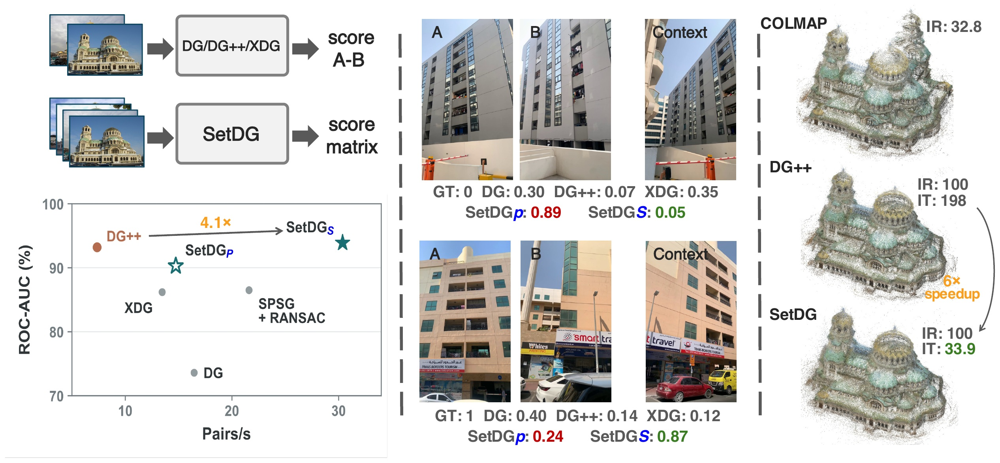
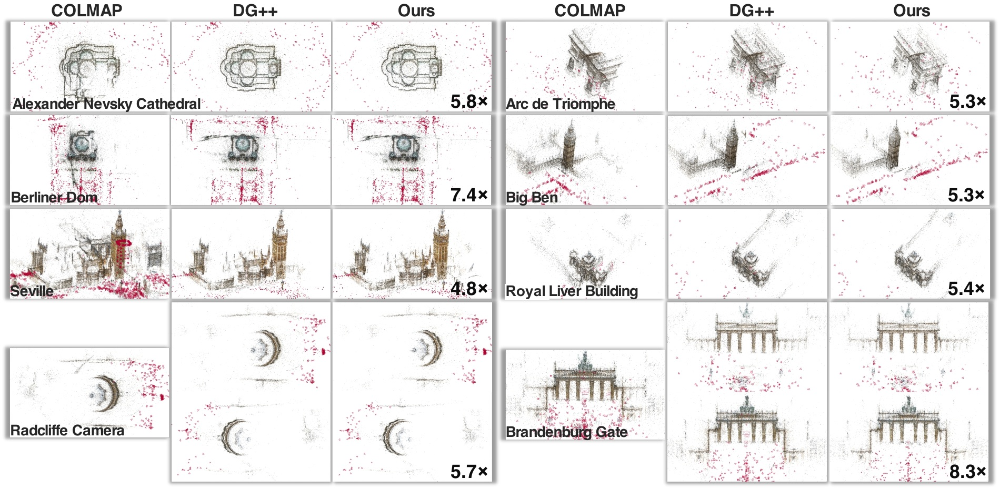

# SetDG

**Efficient Visual Disambiguation with Joint Inference over Image Sets**

SetDG is a visual disambiguation method for Structure-from-Motion (SfM). It jointly scores all image pairs within an image set, using surrounding views to distinguish true visual overlap from similar-looking but different surfaces. Shared visual computation makes pair scoring more efficient and helps build reliable 3D reconstructions.

## Overview

SetDG uses image-set context to improve pair decisions and achieves **4.1× the pair-scoring throughput of Doppelgangers++ (DG++)** with comparable accuracy. The example on the right shows comparable reconstruction quality with approximately **6× faster candidate-pair scoring**. In the figure, P and S denote image-pair and image-set input, respectively; IR is Inlier Ratio (%) and IT is candidate-pair scoring time (minutes).

## Real-Scene Reconstructions

SetDG resolves visual ambiguities in real landmark image collections and recovers scene structures comparable to DG++. **Ours** denotes SetDG; the speedup labels compare candidate-pair scoring time against DG++, excluding the other stages of the SfM pipeline.

## Release

**Our code and models are coming soon.**
